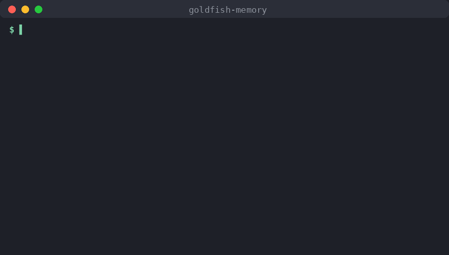
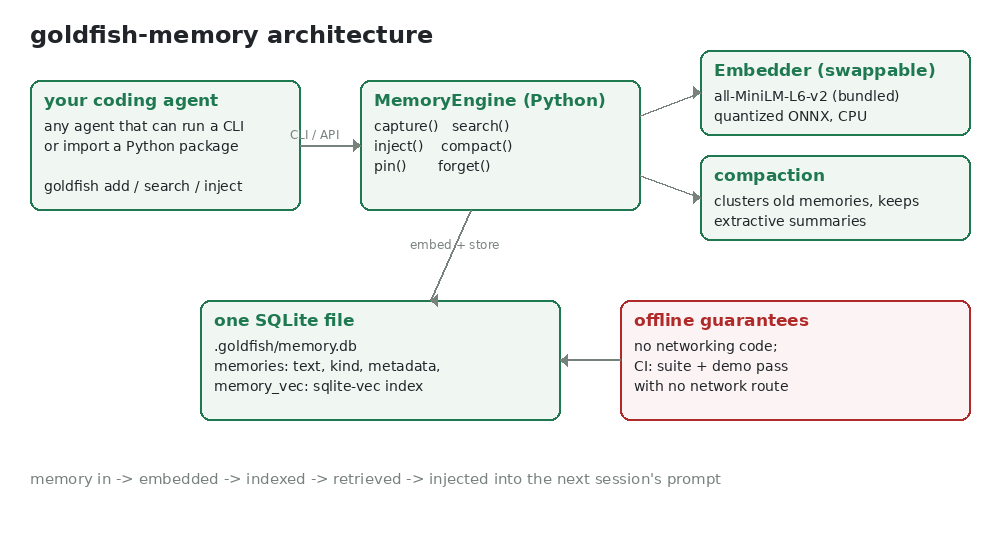

# goldfish-memory

**Your coding agent has the memory of a goldfish. Fix that - on-device.**

Coding agents forget everything when the session ends unless they send your code context to someone's cloud. goldfish-memory gives any coding agent persistent, searchable, cross-session memory that lives in a single local SQLite file - the engine ships **no networking code and downloads nothing at runtime**.

## Demo (30 seconds)



## Quickstart

```bash
pip install git+https://github.com/DhanushNehru/goldfish-memory.git
goldfish demo
```

That is the whole setup: the package bundles its embedding model (23 MB, quantized
[all-MiniLM-L6-v2](https://huggingface.co/sentence-transformers/all-MiniLM-L6-v2), Apache-2.0), so the first command already runs fully offline.

Start remembering in a real project:

```bash
cd your-project
goldfish init
goldfish add --kind decision "Chose Postgres over MySQL for JSONB support"
goldfish add --kind error "Login 500s when the session cookie is missing; fixed in auth.py"
goldfish search "why postgres"
goldfish inject "add password reset to the login flow"   # paste into your agent's next prompt
```

## What it does

| Feature | Command / API | What happens |
|---|---|---|
| Capture | `goldfish add`, `engine.capture(...)` | Store a note/decision/error with metadata and its embedding |
| Semantic search | `goldfish search`, `engine.search(...)` | sqlite-vec kNN over local 384-dim embeddings |
| Injection | `goldfish inject`, `engine.inject(...)` | Markdown block of the most relevant memories, token-budgeted, ready to prepend to a prompt |
| Automatic compaction | `engine.compact()`, runs during capture | Clusters old memories by similarity, keeps extractive summaries, archives originals (auditable, pinned items protected) |
| Control | `goldfish pin/forget/recent/stats` | Pin against compaction, permanently delete, inspect |

Python API:

```python
from goldfish_memory import MemoryEngine

with MemoryEngine() as engine:
    engine.capture("Rate limiting is per-API-key, not per-IP.", kind="decision")
    block = engine.inject("implement the rate limiter", k=6, max_tokens=800)
    print(block.text)  # "## Relevant memory ..." ready for the system prompt
```

## How it works



- **Storage**: one SQLite file. Text and metadata in a `memories` table, embeddings in a `memory_vec` [sqlite-vec](https://github.com/asg017/sqlite-vec) index. No server, no daemon, no account.
- **Embeddings**: pluggable `Embedder` interface. The default is quantized all-MiniLM-L6-v2 running in ONNX Runtime on CPU, with weights bundled in the wheel. Swap in any local model - including a cached sentence-transformers model (`goldfish-memory[sentence-transformers]`, enforced `local_files_only`) - by passing an `Embedder` to the engine or setting `model_dir` / `GOLDFISH_MODEL_DIR`. Nothing is downloaded at runtime.
- **Compaction**: single-pass clustering over stored embeddings plus centroid-ranked extractive summaries. No LLM call, no network - just the embeddings already on disk.

## Why local?

- **Privacy**: your codebase's decisions and bugs never leave the machine - the engine ships no networking code, so there is nothing to leak through.
- **Zero cost**: no API keys, no per-call fees, no quota.
- **Works anywhere**: planes, trains, air-gapped networks, CI runners.
- **Yours**: the store is a SQLite file you can copy, back up, grep, or delete.

## Offline by design, verified in CI

The engine - capture, search, injection, compaction, model initialization, and every bundled adapter - is built with no networking code and never downloads at runtime. The only step that ever needs the network is installing the package itself; the default model is bundled, so there is no provisioning step and no runtime download. (If the bundled weights are deliberately stripped for a lean build, the engine fails fast with instructions instead of downloading.)

CI verifies this on the tested paths: the full test suite runs with Python sockets disabled ([pytest-socket](https://github.com/miketheman/pytest-socket)), and the suite plus a fresh `goldfish demo` also pass inside a Linux network namespace with no external route (`unshare -n`), which blocks native code paths such as ONNX Runtime and the tokenizer too. That is evidence about the shipped implementation and the paths the tests exercise - not a proof about code that does not exist yet.

## Benchmark

`python scripts/benchmark.py` compares goldfish-memory against the naive full-history approach (dump the whole history into the prompt, or rescan every embedding at query time) on a synthetic 2,000-memory store with one buried fact-bearing memory per topic:

| Metric | goldfish-memory | Naive full-history |
|---|---|---|
| Retrieval latency / query | 13.1 ms | 11.9 ms (numpy rescan) |
| Tokens handed to the agent | ~189 | ~49,975 |
| Buried fact included within an 800-token context budget | 100% | 0% |

Honest reading: at this size both retrieval paths are exact scans, so latency is a wash - the win is **context economy**. The full history *contains* every fact, but 50k tokens don't fit a real context window; within an 800-token budget the naive dump never reaches the buried fact, while retrieval surfaces it every time. This measures context-budget fit, not model answer quality. Full methodology and environment: [BENCHMARKS.md](BENCHMARKS.md).

## Roadmap

Planned next steps are tracked as issues:

1. Encrypted-at-rest storage option (SQLCipher)
2. Per-project memory scoping across monorepos
3. Scheduled background compaction daemon
4. Signed Windows + macOS binaries
5. Memory export/import format
6. Expanded quality-benchmark suite vs the full-history baseline
7. VS Code extension showing injected memories
8. Docs site with integration guides for popular agents

## Adopting it in your agent

See [SKILL.md](SKILL.md) - one file your coding agent can read to start capturing and injecting memory in minutes.

## Contributing

Contributions welcome - see [CONTRIBUTING.md](CONTRIBUTING.md). Tests, lint (`ruff`), and type checks (`mypy --strict`) run in CI on every PR.

## License

MIT - see [LICENSE](LICENSE). Bundled model weights and third-party attributions: [NOTICE](NOTICE).
